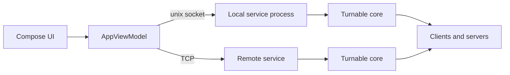

# Turnable App &nbsp;·&nbsp; [🇷🇺 RU](README_RU.md)
Turnable App is the Android and desktop client for [Turnable](https://github.com/TheAirBlow/Turnable), a VPN core that tunnels TCP and UDP traffic through platform call infrastructure. The app runs a local core service, connects to remote services, and keeps client and server instances in one place. It is written in Kotlin with Compose Multiplatform.

> [!NOTE]
> The app controls a Turnable core, it does not replace one. A local service downloads the matching core release from GitHub on first start, and a remote service has to be running already.

## Features
1. Clients grouped by subscription, with usage, expiry, announcements and support links
2. Plain client mode by default, with services, servers and providers behind an advanced switch
3. Local services that download and run Turnable releases, or any custom core binary
4. Remote services over TCP, with optional ML-KEM-768 authentication and server key pinning
5. Subscriptions over HTTP, refreshed automatically and retried after a failure
6. Manual captcha solving with notifications, and an in-app page on Android
7. Server management: config, live logs, traffic stats, sessions and kicking
8. Provider management: routes, users and config sharing
9. Backup and restore of services and subscriptions through the clipboard
10. English and Russian UI that follows the system language

## How it works
The app is a controller. The Turnable core does the tunneling, either as a service process on the same device or as a service reached over the network. Both use service protocol v3.



On first launch the app creates the `local` service. When a service enables authentication, its `allowed_keys` must contain the app's public key. The app can also pin the service's public key and refuse to connect to anything else.

Subscriptions are HTTP URLs that return `turnable://` links, plain or base64 encoded. The app turns each link into a client instance with its own local listen port and matches it across updates, so a renamed or changed link keeps its instance. Panels using [Frostbite](https://github.com/TheAirBlow/Frostbite) serve these links when the user agent starts with `Turnable-Android`. Turnable is only a tunnel, so apps still need a VPN or proxy client pointed at the client's listen address.

When the platform asks for a captcha, the core reports it and the client waits. The app shows a notification and opens the solve screen. On Android the call page runs inside the app with a fresh anonymous session. On desktop the solve screen links the service's userscript and the call page, which you open in a private window, and the script sends the tokens back to the service.

## Requirements
- Turnable v0.8.4 or newer for local services. A custom core binary skips this check.
- Internet access on first start, to download the core.
- For remote services, a reachable service address. If authentication is on, its `allowed_keys` must contain the app's public key.

## Building
Pre-built packages are on the [releases page](https://github.com/TheAirBlow/TurnableApp/releases): an Android APK, Linux `.deb`, Windows `.msi` and macOS `.dmg`.

Building requires JDK 21 and, for Android, the Android SDK with API 37. The Android target is pinned to SDK 28 because newer targets block `exec()` of the downloaded core.

```bash
./gradlew :composeApp:run              # desktop
./gradlew :androidApp:assembleDebug    # Android debug APK
./gradlew :composeApp:jvmTest          # tests
```

Set `TURNABLE_BIN` to a Turnable binary to also run the interop tests against a real service. Packaging, signing, icons and localization are covered in [the build guide](BUILD_AND_DEPLOY.md).

## Setup
1. Install the app from the releases page, or build it from source.
2. Open the Clients tab and add a subscription URL from your provider, or paste a `turnable://` link. The add menu has both.
3. Start the clients you need. Point your VPN or proxy client at the listen address shown for each one.

Plain mode runs the local service and only shows Clients and Settings. Turn on Advanced mode in Settings to manage services, servers and providers:

- Services: run a local Turnable release, pick another version, use a custom core binary, or connect to a remote service over TCP.
- Servers: create relay servers from a provider, then watch logs, stats and live sessions.
- Providers: keep routes and users, and share a config with a server.

Desktop data lives in `~/.turnable`, or in `$TURNABLE_HOME` when set. On Android it stays in the app's private storage. Setting up the core itself, including service keys and server configs, is covered in the [Turnable documentation](https://github.com/TheAirBlow/Turnable/tree/main/docs).

## Limitations
- There is no iOS app.
- Desktop has no embedded browser for captchas, so they are solved in the system browser with the service's userscript.
- The client forms cover relay and direct connections. P2P is not offered yet; the core lists it as work in progress.

## Credits
- [Turnable](https://github.com/TheAirBlow/Turnable) - the core and service protocol this app drives.
- [vk-turn-proxy](https://github.com/cacggghp/vk-turn-proxy) - the original project Turnable is partially based on.

## License
[GNU General Public License v2.0](LICENSE)
