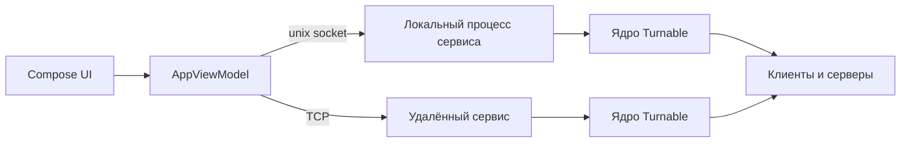

# Turnable App &nbsp;·&nbsp; [🇺🇸 EN](README.md)
Turnable App - клиент для Android и десктопа к [Turnable](https://github.com/TheAirBlow/Turnable), VPN ядру, которое туннелирует TCP и UDP трафик через инфраструктуру звонков платформ. Приложение запускает локальный сервис ядра, подключается к удалённым сервисам и держит клиентов и серверы в одном месте. Написано на Kotlin и Compose Multiplatform.

> [!NOTE]
> Приложение управляет ядром Turnable, но не заменяет его. Локальный сервис скачивает подходящий релиз ядра с GitHub при первом запуске, а удалённый сервис уже должен работать.

## Возможности
1. Клиенты, сгруппированные по подписке, с расходом трафика, сроком действия, объявлениями и ссылками поддержки
2. Обычный режим клиента по умолчанию. Сервисы, серверы и провайдеры скрыты за расширенным режимом
3. Локальные сервисы, которые скачивают и запускают релизы Turnable, или своё ядро
4. Интерфейс на английском и русском, следует языку системы

## Как это работает
Приложение - это контроллер. Туннелированием занимается ядро Turnable: либо процесс сервиса на том же устройстве, либо сервис, доступный по сети. Оба говорят по протоколу сервиса v3.



При первом запуске приложение создаёт сервис `local`. Когда в сервисе включена аутентификация, его `allowed_keys` должен содержать публичный ключ приложения. Приложение также может закрепить публичный ключ сервиса и отказываться подключаться к чему-то другому. По умолчанию приложение работает в обычном режиме: запускает локальный сервис и показывает только «Клиенты» и «Настройки». Включи расширенный режим в настройках, чтобы управлять сервисами, серверами и провайдерами.

Данные приложения на десктопе лежат в `~/.turnable` или в `$TURNABLE_HOME`, если переменная задана. На Android они остаются во внутреннем хранилище приложения. Настройка самого ядра, включая ключи сервиса и конфиги серверов, описана в [документации Turnable](https://github.com/TheAirBlow/Turnable/tree/main/docs).

## Требования
- Turnable v0.8.4 или новее для локальных сервисов. Своё ядро пропускает эту проверку.
- Доступ в интернет при первом запуске, чтобы скачать ядро.
- Для удалённых сервисов - доступный адрес сервиса.

## Сборка
Готовые сборки лежат на [странице релизов](https://github.com/TheAirBlow/TurnableApp/releases): APK для Android, Linux `.deb`, Windows `.msi` и macOS `.dmg`.

Для сборки нужны JDK 21 и, для Android, Android SDK с API 37. Целевая версия Android закреплена на SDK 28: более новые версии запрещают `exec()` для скачанного ядра.

```bash
./gradlew :composeApp:run              # десктоп
./gradlew :androidApp:assembleDebug    # debug APK для Android
./gradlew :composeApp:jvmTest          # тесты
```

Укажи `TURNABLE_BIN` на бинарник Turnable, чтобы дополнительно прогнать интеграционные тесты против настоящего сервиса. Упаковка, подпись, иконки и локализация описаны в [руководстве по сборке](BUILD_AND_DEPLOY.md).

## Настройка
1. Установи приложение со страницы релизов или собери его сам.
2. Открой вкладку «Клиенты» и добавь ссылку на подписку от провайдера или вставь выданную ссылку `turnable://`. В меню добавления есть оба варианта.
3. Запусти нужных клиентов. Направь свой VPN или прокси клиент на адрес прослушивания, который показан у каждого клиента.

## Ограничения
- Приложения для iOS нет.
- На десктопе нет встроенного браузера для капчи, поэтому она решается в системном браузере через юзерскрипт сервиса.
- Формы клиента покрывают relay и direct подключения. P2P пока не предлагается, ядро помечает его как незавершённое.

## Респект
- [Turnable](https://github.com/TheAirBlow/Turnable) - ядро и протокол сервиса, которыми управляет приложение.
- [vk-turn-proxy](https://github.com/cacggghp/vk-turn-proxy) - оригинальный проект, на котором частично основан Turnable.

## Лицензия
[GNU General Public License v2.0](LICENSE)
